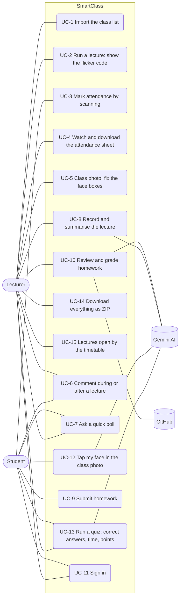

# Main use cases (client stories)

Actors: **Lecturer**, **Student**, and the external services **Gemini** (AI) and **GitHub**.

---

## UC-1 Import the class list
**Story:** As a lecturer, I want to load the Moodle participants file, so that only my students can sign in.
- **Pre:** the lecturer is signed in.
- **Main flow:** 1) Lecturer opens *Class list* → *Import*. 2) Chooses the Moodle CSV or XLSX. 3) The system reads the Hebrew headers, lower-cases the emails, marks rows without a group as staff. 4) The list is saved and shown.
- **Alternative:** a row without an email is skipped; a duplicate email is kept once.
- **Post:** students on the list can sign in. (FR-AUTH-3)

## UC-2 Run a lecture
**Story:** As a lecturer, I want one button that starts the lecture and shows the attendance code, so that I don't waste class time.
- **Main flow:** 1) *Start lecture*. 2) The system creates the lecture (short id) and the first secret token. 3) The flicker code appears; *Full screen* fills the projector. 4) Every 5 s a new token is published and drawn.
- **Alternative:** the network drops → the code keeps the last token and retries every 3 s.
- **Post:** students can scan. (FR-ATT-1..3)

## UC-3 Mark attendance by scanning
**Story:** As a student in the room, I want to mark my attendance in a few seconds, and nobody at home should be able to do it with a photo.
- **Pre:** the student is signed in; the lecture's code is on the screen.
- **Main flow:** 1) *Start camera*. 2) The student points the phone at the screen (zooms with + / − or pinch if far). 3) The scanner builds the change map, finds the code, zooms in on it and reads it (~1–3 s). 4) The phone vibrates; the system writes the record "in class". 5) The page shows **🏫 Physical attendance, in class**.
- **Alternatives:** 3a) A photo or a frozen picture → nothing is read ("what the scanner sees" stays grey). 4a) Already marked → "You are already marked". 4b) Offline → saved on the phone, "waiting to send", sent automatically. 4c) An old or foreign code → "not a valid code".
- **Post:** the lecturer's list and counter update live. (FR-ATT-4..8)

## UC-4 Watch and download the attendance sheet
**Story:** As a lecturer, I want a spreadsheet of all my lectures, so that I can grade attendance.
- **Main flow:** 1) *Sheet* tab. 2) The table shows one row per student and one column per lecture (V / M). 3) *Download XLSX* saves the file.
- **Alternative:** offline → the sheet is built from the local copy.
- (FR-ATT-9, FR-ATT-10)

## UC-5 Class photo: fix the face boxes
- **Actor:** Lecturer. **Pre:** a lecture is open.
- **Main flow:** 1) *Take a class photo*. 2) The system finds the faces (MediaPipe in the browser, plus Gemini when AI is set up) and shows a box on each, with the count above. 3) The lecturer taps a wrong box to remove it, taps a face without a box to add one (undo, retake, zoom). 4) *Save and show to students*.
- **Alternative:** automatic finding fails (no internet) → the lecturer adds the boxes by tapping.
- **Post:** students who scanned are asked to tap their face; the lecturer sees confirmed / waiting / not-in-photo and the names on the faces. (FR-ATT-11, 12, 15)

## UC-6 Comment during or after a lecture
**Story:** As a student, I want to ask a question without speaking up, anonymously if I choose.
- **Main flow:** 1) *Lecture* tab → type. 2) Choose public/private and anonymous/with name. 3) *Send*. 4) The lecturer sees it live; public comments are seen by all.
- **Alternatives:** offline → waits and is sent later; a past lecture → the comment is added to that lecture.
- (FR-COM-1..6)

## UC-7 Ask a quick poll (KISS)
**Story:** As a lecturer, I want to ask the class a question and see the answers immediately.
- **Main flow:** 1) Polls & quizzes card: type a question and 2–6 answers → *Ask now*. 2) It opens on every phone (🔔) and on the projector with live bars. 3) Students tap one answer, once. 4) *Close and show results* → phones show the bars with *mine* marked.
- **Alternatives:** fewer than 2 answers → refused; a student closed the panel → *answer* button in the Lecture tab; a correct answer or a time can be added → UC-13.
- (FR-POLL-1..3)

## UC-8 Record and summarise the lecture
**Story:** As a lecturer, I want a summary of my lecture, so that students can review it.
- **Pre:** the course admin stored the AI key once (Firestore `config/ai`); the lecturer types nothing.
- **Main flow:** 1) *Record* (or upload a recording). 2) Every piece is transcribed (Whisper, Hebrew) and stored. 3) *Make summary* → the LLM writes topics, key points and questions. 4) Students read the summary.
- **Alternative:** the admin has not stored the key → the page says AI is not set up for the course.
- (FR-SUM-1..3)

## UC-9 Submit homework
**Story:** As a student, I want to hand in my repository link and files in one place.
- **Main flow:** 1) *Assignments* → choose one. 2) Paste a GitHub link and/or attach text files (≤ 500 KB). 3) *Submit*.
- **Alternative:** a non-http link → refused; offline → waits and is sent later.
- (FR-HW-2)

## UC-10 Review and grade homework
**Story:** As a lecturer, I want an AI first review that also compares each student with the class.
- **Main flow:** 1) Lecturer opens the submissions. 2) *Review all* → for each submission the system reads the repo (README first, up to 25 code files), adds anonymous summaries of the other submissions, and asks the LLM. 3) The lecturer edits the review, gives a grade and feedback. 4) The student sees them and gets a notification.
- (FR-HW-1, FR-HW-3, FR-HW-4)

## UC-12 Tap my face in the class photo
- **Actor:** Student. **Pre:** scanned the code (UC-3).
- **Main flow:** 1) The photo opens (a notification when it arrives later). 2) The student zooms and taps their face. 3) The face is shown enlarged: *Is this you?* 4) *Yes* → attendance confirmed; the face turns grey for everyone else.
- **Alternatives:** the face is taken → "tell the lecturer"; *I can't find myself* → the lecturer sees the name at once; a new photo → choose again.
- **No box on me:** the student taps where he sits (also at the edge of the photo) → *Send* → "checking". Gemini looks at that part of the photo: a person → the box is added and the attendance confirmed; no → "not approved", and the lecturer can still approve.
- (FR-ATT-13, FR-ATT-14, FR-ATT-16)

## UC-13 Run a quiz: correct answers, time, points (Kahoot style)
- **Actors:** Lecturer, Students, Gemini (optional). The same feature as UC-7, with correct answers and/or time.
- **Main flow:** 1) The lecturer writes the questions, marks the correct answers and a time (or *✨ AI writes questions* from the transcript or a topic) and saves. 2) *Run* → the projector shows the lobby; the phones open the quiz by themselves. 3) *Start* → a question with its timer (if any); students tap one of the coloured buttons. 4) Time up or everyone answered → answer bars and the correct answer; each phone shows right / wrong and the points. 5) *Leaderboard* (top 5) → *Next* … → podium.
- **Alternative:** an answer after the time → "time is up" (refused by the rules).
- (FR-QZ-1..5)

## UC-14 Download everything as ZIP
- **Actor:** Lecturer. **Main flow:** Sheet tab → *Everything as ZIP* → one organised folder per lecture and per assignment, plus the class list and the attendance XLSX. (FR-GEN-4)

## UC-15 Lectures open by the timetable
- **Actor:** Lecturer (once), the system. **Main flow:** 1) Live tab → *Lecture times* → add day, start, end, name → *Save*. 2) At the time, the lecturer's page (open on the classroom computer) opens the lecture by itself. 3) Students' phones show "the lecture started". (FR-SES-1, FR-SES-2)

## UC-11 Sign in
- **Student:** *Sign in with Google* → the email must be on the class list, otherwise "not on the list".
- **Lecturer:** email + password of the lecturer account (`staff/{uid}`).
- **Local test server:** students type their email; the lecturer types the password shown in the server window.
- (FR-AUTH-1, FR-AUTH-2)
