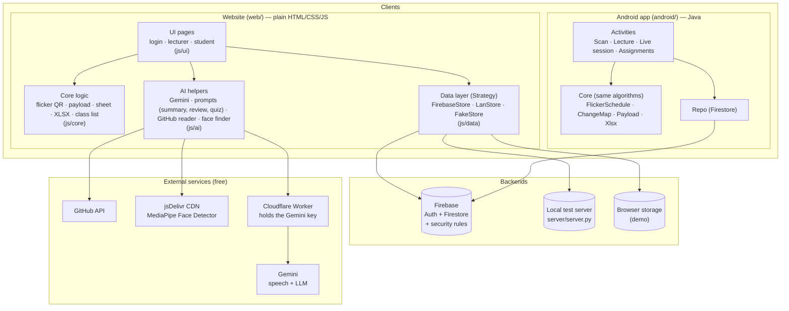

# Main software components

## Components

| Component | Responsibility | Main files | Depends on |
|---|---|---|---|
| **Flicker QR (core)** | Screen side: which colour each square shows in each phase. Scanner side: the change map, finding the code's box, the black-and-white image a QR reader can read. | `web/js/core/noisyqr.js` · `android/.../core/FlickerSchedule.java`, `ChangeMap.java` | qrcode-generator, jsQR / ZXing |
| **Payload** | The QR text `SC2/<lecture>/<token>`, random tokens and lecture ids, "current or previous" rule. | `web/js/core/payload.js` · `Payload.java` | — |
| **Attendance sheet + XLSX** | Rows × lectures table; reading and writing `.xlsx` without a library. | `web/js/core/sheet.js`, `xlsx.js` · `AttendanceSheet.java`, `Xlsx.java` | — |
| **Class list** | Parses the Moodle CSV/XLSX export. | `web/js/core/classlist.js` · `ClassList.java` | XLSX |
| **QR display** | Draws the flicker code 30 times a second; rotates the token every 5 s. | `web/js/ui/qr-display.js` · `QrNoiseView.java`, `LiveSessionActivity.java` | Flicker QR, Payload |
| **Scanner** | Camera → change map → auto-zoom → decode; zoom buttons and pinch; "what the scanner sees". | `web/js/ui/scanner.js` · `QrAnalyzer.java`, `ScanActivity.java` | Flicker QR |
| **Data layer (Strategy)** | One interface (`signIn…`, `createSession`, `publishCode`, `markMe`, `watch…`, `addComment`, `vote`, `submit`, …) with three implementations. | `web/js/data/store.js` picks one: `firebase-store.js`, `lan-store.js`, `fake-store.js` · `Repo.java` | Firebase SDK / fetch / localStorage |
| **Security rules** | Every check that matters on the free plan: a student writes only their own record, once, with a real token; codes and the class list are hidden. | `firestore.rules` | Firestore |
| **Local test server** | The same rules in Python for testing on real phones over Wi-Fi before Firebase. | `server/server.py` | Python standard library |
| **AI** | Transcription and chat (Gemini, built-in key read from Firestore by the lecturer only), summary and review prompts, GitHub repository reader, people detection. | `web/js/ai/*.js` · `android/.../ai/*.java` | Gemini, GitHub API, TF.js |
| **UI pages** | Login, lecturer (live lecture, sheet, class list, assignments, settings), student (scan, lecture, assignments); Hebrew/English. | `web/*.html`, `web/js/ui/*.js` · `android/.../ui/*.java` | all of the above |

## Design choices

- **Strategy pattern for data.** The pages call one interface; `store.js` chooses Firebase, the
  local server (`?lan=1`) or the in-browser demo (`?demo=1`). The same page code runs in all three,
  which let us test on real phones before Firebase existed.
- **Same core in two languages.** The JS core and the Java core implement the same algorithms
  with the same constants and the same test names (TC-QR-*, TC-PL-*, …).
- **No server code.** On the free plan the security rules are the server: they check the
  token, the owner and "once".
- **The AI key is built in but private.** The course admin stores it once in Firestore
  (`config/ai`); the rules let only the lecturer read it. The lecturer never types it, students
  never see it, and it is not in the code or on GitHub.
