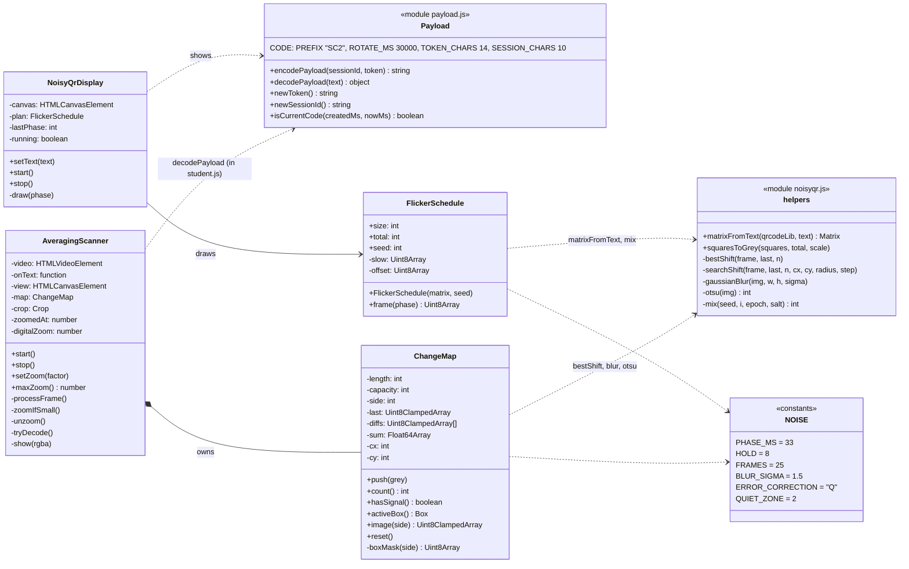
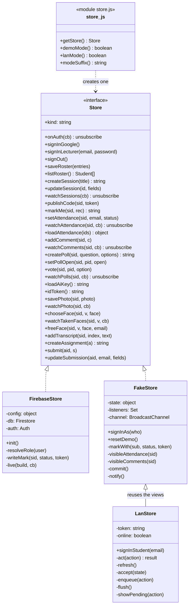
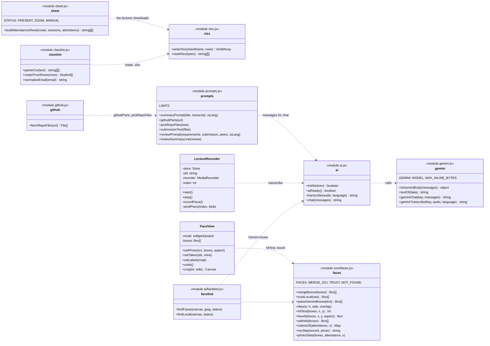
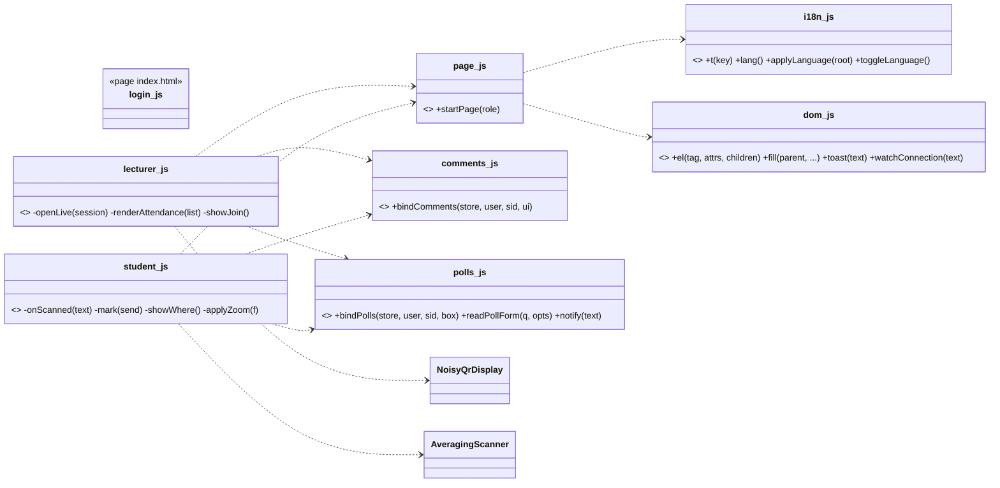
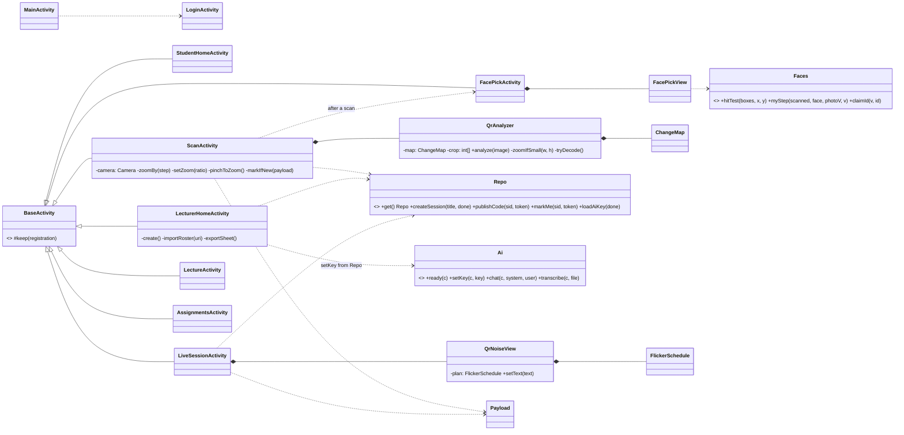

# Low-level class diagrams

The diagrams show the real classes and functions in the code (names as in the source). JavaScript
modules that export plain functions are drawn as `<<module>>` classes.

## 1. The flicker QR (attendance core)

Screen side (`FlickerSchedule`, `NoisyQrDisplay`) and scanner side (`ChangeMap`, `AveragingScanner`).
The Java app has the same classes (`FlickerSchedule.java`, `ChangeMap.java`, `QrNoiseView.java`, `QrAnalyzer.java`).

## 2. The data layer (Strategy pattern)

## 3. Core logic and AI helpers

## 4. Pages (web UI)

## 5. Android app (Java)

