# Sequence diagrams

## SD-1 Open a lecture and show the flicker code (UC-2)

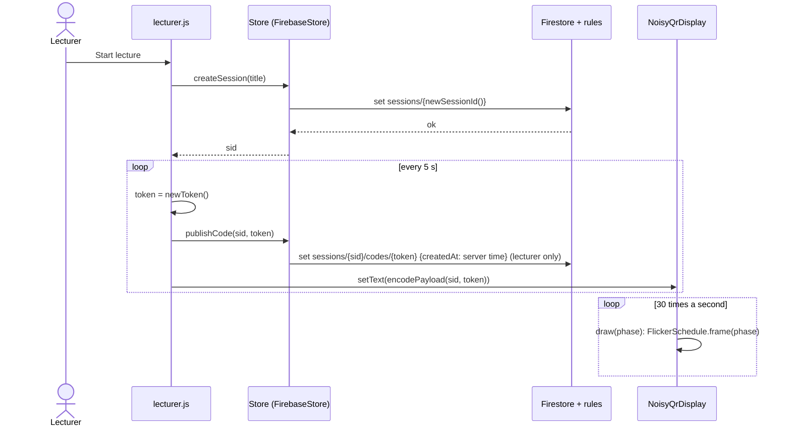

## SD-2 A student marks attendance by scanning (UC-3, the main flow)

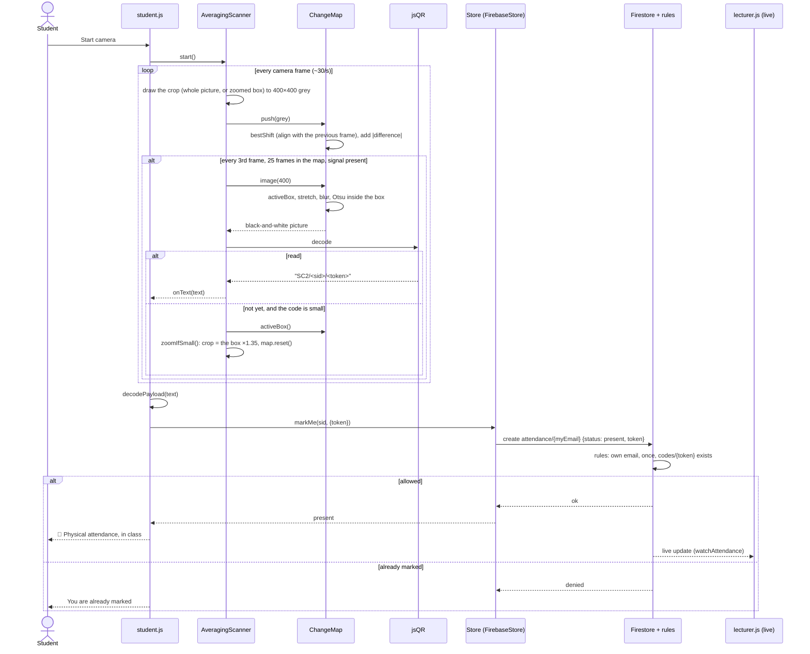

## SD-3 Why a photo fails (NFR-2)

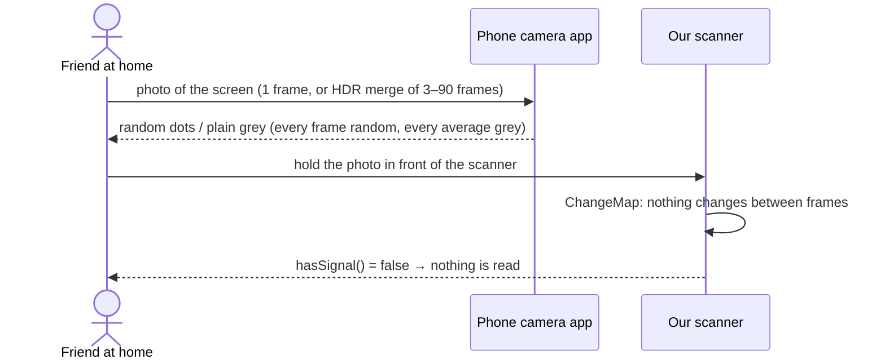

## SD-4 Attendance sheet (UC-4)

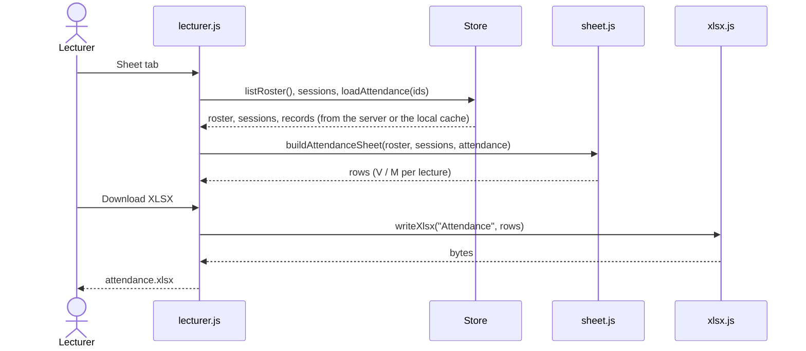

## SD-5 An offline comment (UC-6, FR-GEN-2)

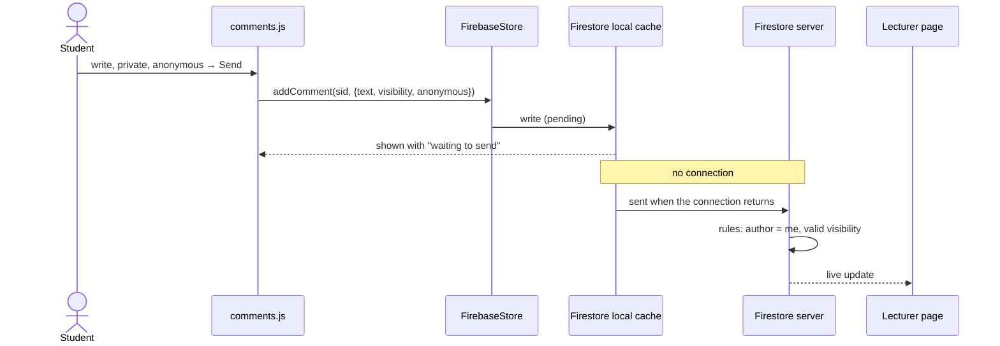

## SD-6 Quick poll, KISS (UC-7)

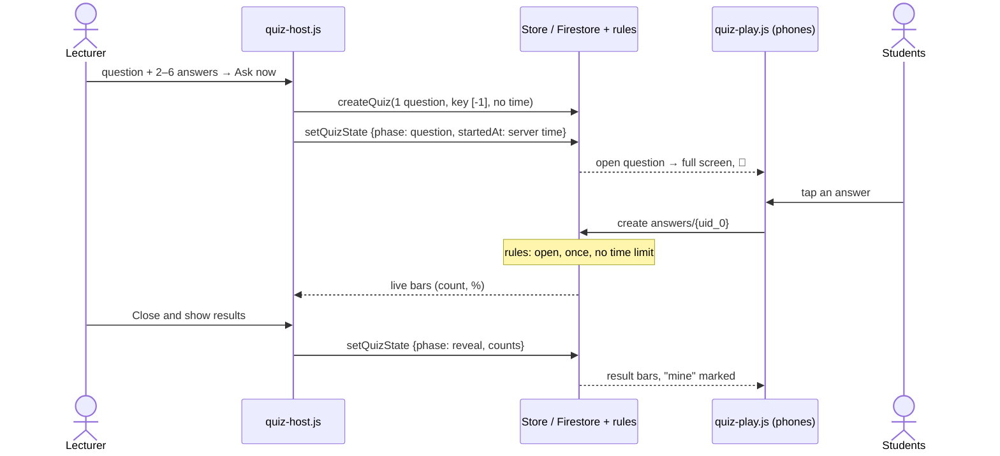

## SD-7 Recording and AI summary (UC-8)

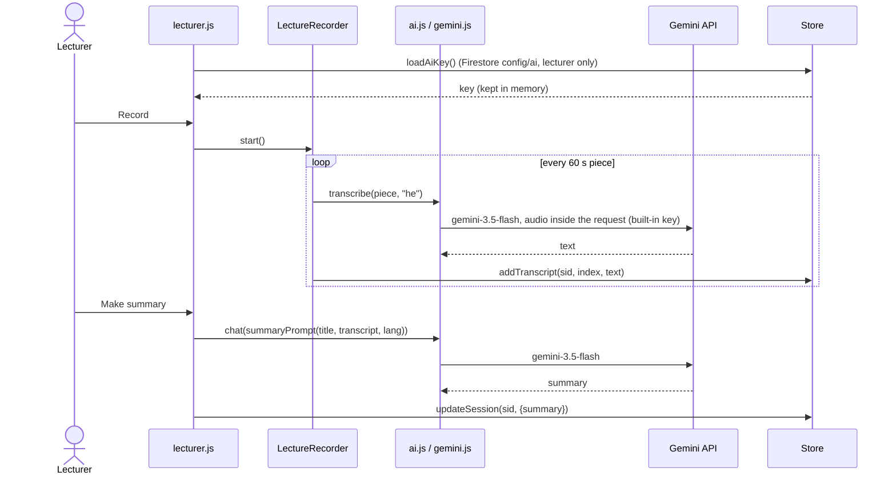

## SD-8 Homework review compared with the class (UC-10)

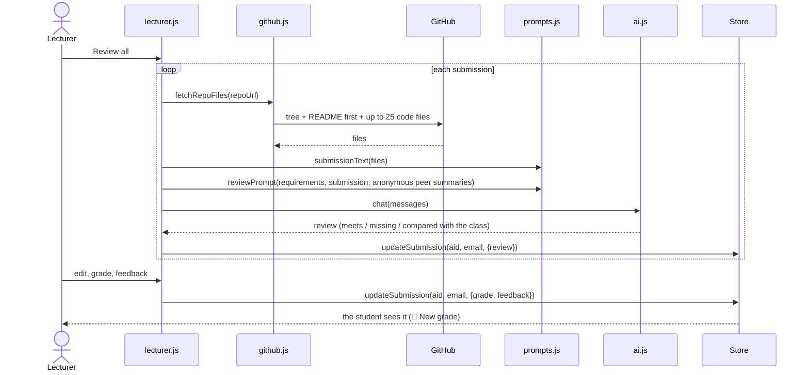

## SD-9 Class photo: boxes on faces, each student taps their own (UC-5, UC-12)

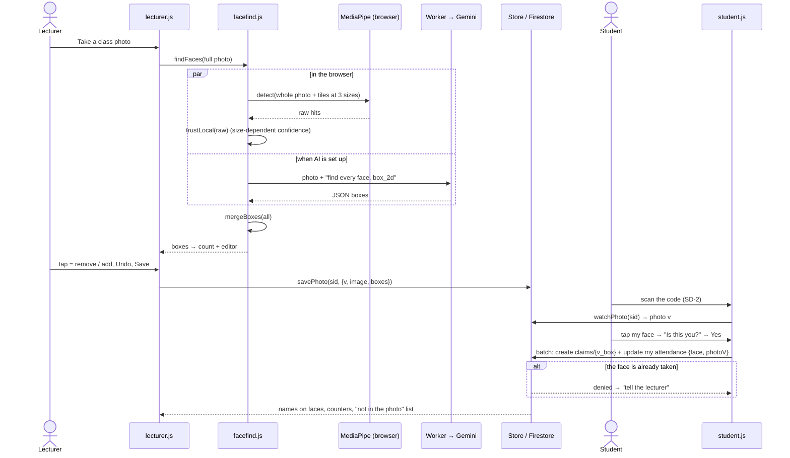

## SD-10 Quiz with correct answers and time, Kahoot style (UC-13)

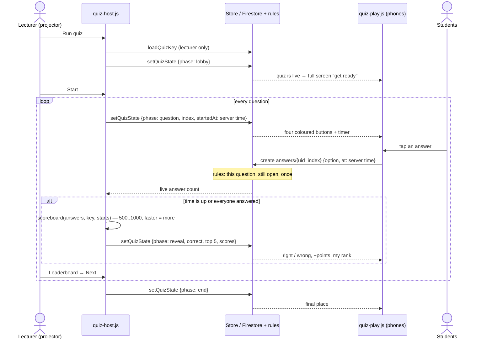

## SD-11 "No box on me", checked by Gemini (UC-12)

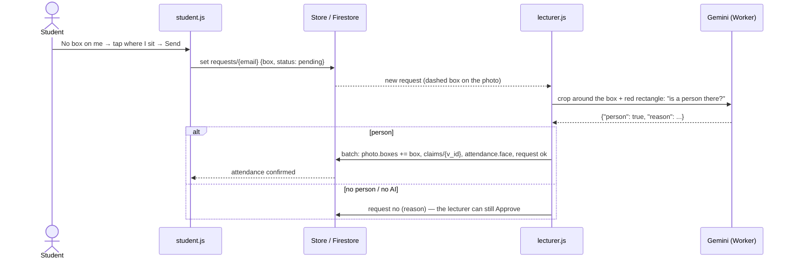
